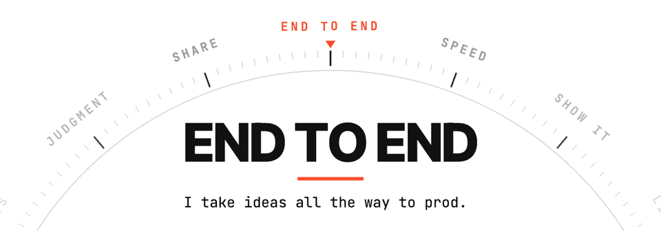

> Talk is cheap. Show me the prompt.

Hey, I'm Stéphane. I co-founded [Conduktor](https://conduktor.io), where we build tools for teams running Kafka.

<picture>
  <source media="(prefers-color-scheme: dark)" srcset="assets/values-dark.gif">
  
</picture>

I also build a lot on the side: CLIs, Chrome extensions, macOS apps, small games. Most of them are a way to push LLMs as far as they go, and see where they stop. Some get finished. All of them end up here.

If you build with LLMs too, we're probably hitting the same walls and having the same epiphanies. I share both as I go, the stuff that broke and the stuff that finally clicked. Follow me here for the repos and on [LinkedIn](https://www.linkedin.com/in/stephane-derosiaux/) for the stories behind them.

Building something with LLMs? Tell me about it on LinkedIn. I love hearing what people are making.
